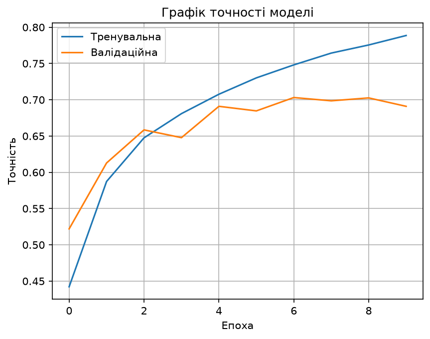

# cifar10-cnn

A simple convolutional neural network (CNN) that classifies images from the CIFAR-10 dataset, made for learning machine learning with TensorFlow/Keras.

## What is it

A Python script that trains a small CNN on CIFAR-10 (32×32 color images in 10 classes: airplane, automobile, bird, cat, deer, dog, frog, horse, ship, truck). After training, it shows the test accuracy, saves a training graph, and can classify your own image.

Test accuracy: about 71%.



## How to run

1. Install [Python](https://www.python.org/downloads/) and the libraries:
   ```
   pip install -r requirements.txt
   ```
2. Run the script:
   ```
   python cifar10_cnn.py
   ```
   The dataset is downloaded automatically on the first run. Close the graph window to continue.
3. To classify your own image, put it next to the script and set its name in the `custom_image_path` variable (default: `my_image.jpg`).

## Important note

The model knows only the 10 CIFAR-10 classes, so it will always pick one of them, even if the picture shows something else. Images are resized to 32×32, so photos with one large object in the center work best.

The program is in Ukrainian: the code comments, the console messages, the class names in the predictions and the graph labels are all in Ukrainian.

Training runs on the CPU and takes a few minutes.

## Status

This is an old version and is no longer developed.
